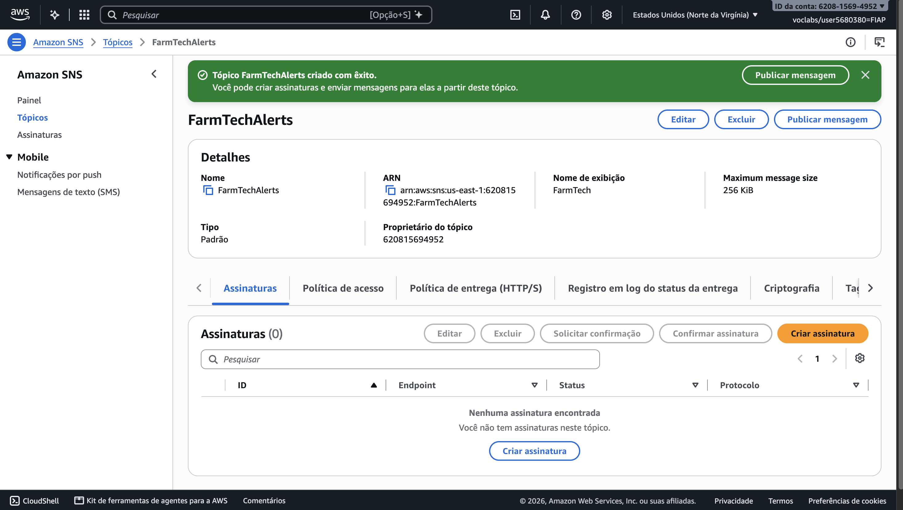
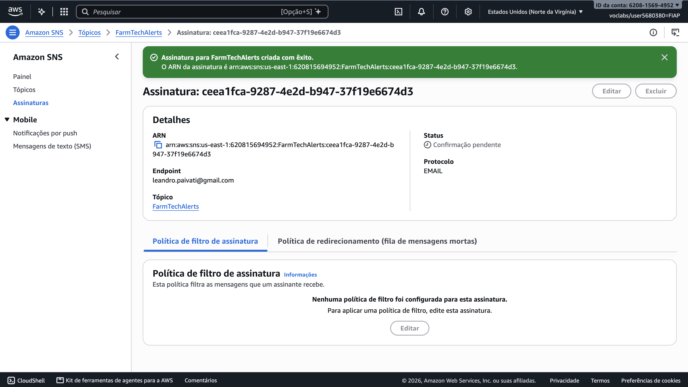
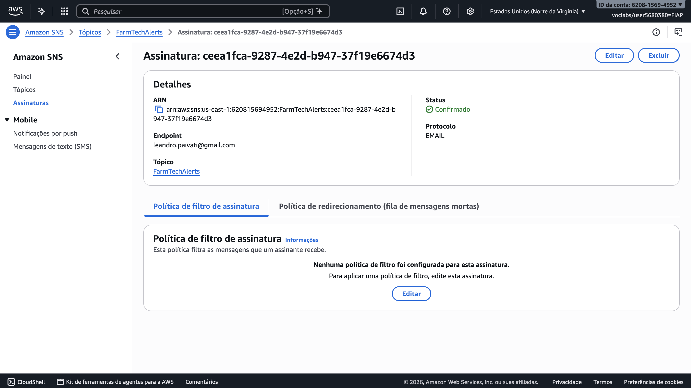
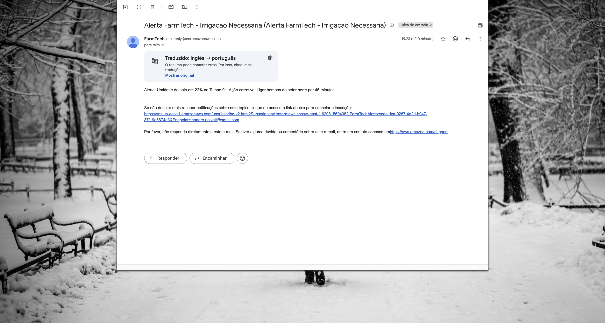
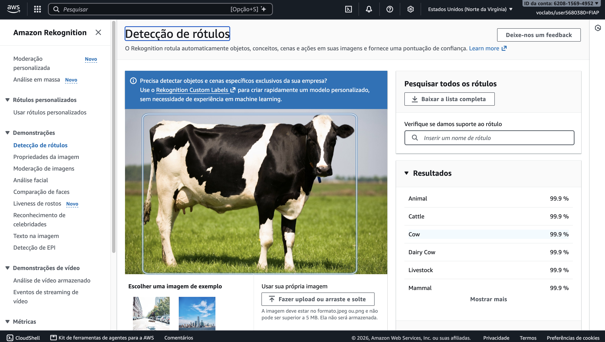

# FIAP - Faculdade de Informática e Administração Paulista

<p align="center">
  <a href="https://www.fiap.com.br/">
    
  </a>
</p>

---

# FarmTech Solutions — Fase 7 | A Consolidação de um Sistema

## 📋 Informações do Projeto
- **Curso:** Inteligência Artificial aplicada à Agricultura 4.0
- **Fase:** 7 — A Consolidação de um Sistema (Capítulo 1)
- **Startup Acadêmica:** FarmTech Solutions

## 👥 Integrantes do Grupo
- **Caroline Coelho Mendes** — RM 570370
- **Leandro Paiva** — RM 572159
- **Lucas Viana de Lima** — RM 571835

## 👩‍🏫 Professores

### Tutor(a)
- **[INSERIR NOME DO(A) TUTOR(A)]**

### Coordenador(a)
- **[INSERIR NOME DO(A) COORDENADOR(A)]**

---

## 📖 Visão Geral e Arquitetura Consolidada

A **FarmTech Solutions** conclui seu ciclo de inovação consolidando em uma estação operacional unificada todas as soluções desenvolvidas da Fase 1 à Fase 6. O ecossistema transforma medições agrícolas isoladas em um ambiente integrado de **Agricultura 4.0**, agregando:
1. **Engenharia de Dados & Clima (Fase 1):** Dimensionamento e manejo de talhões, estimativas de NPK e integração de API meteorológica pública de São Paulo com análise estatística em R.
2. **IoT, Telemetria & Automação de Irrigação (Fase 2):** Sensores de umidade de solo, microclima (DHT22) e nutrientes em microcontrolador ESP32 com acionamento inteligente de bombas d'água.
3. **Banco de Dados Estruturado (Fase 3):** Modelagem relacional e persistência estruturada de telemetria e controle em Oracle Database.
4. **Data Science & Aprendizado de Máquina (Fase 4):** Modelos de regressão preditiva para estimativa de produtividade de safra (`crop_yield.csv`).
5. **Computação em Nuvem & Segurança (Fase 5):** Arquitetura segura na nuvem AWS, gestão de identidade (IAM) e conformidade com boas práticas (ISO 27001).
6. **Visão Computacional & Redes Neurais (Fase 6):** Pipeline de detecção de objetos via YOLOv5 para monitoramento visual em campo (bovinos e maquinário agrícola).
7. **Consolidação & Mensageria Cloud (Fase 7):** Dashboard única responsiva (Streamlit), autenticação simulada com troca obrigatória de credenciais, gestão ativa de talhões e sistema de alertas em nuvem via **Amazon SNS**.

### Diagrama Arquitetural do Ecossistema

```text
       [ Sensores de Campo: DHT22 / Umidade / ESP32 ]       [ Câmeras de Monitoramento / YOLOv5 ]
                              │                                                │
                              ▼                                                ▼
              [ Ingestão e Processamento Local / Streamlit (app.py) ]
                                      │
              ┌───────────────────────┴───────────────────────┐
              ▼                                               ▼
[ Banco Relacional Oracle / Telemetria ]     [ Camada Cloud AWS: Amazon SNS ]
                                                              │
                                            ┌─────────────────┴─────────────────┐
                                            ▼                                   ▼
                               [ Alertas via E-mail ]                  [ Alertas via SMS ]
                                      │                                         │
                                      └─────────────────┬───────────────────────┘
                                                        ▼
                                       [ Ações Corretivas Operacionais ]
```

---

## Boas Práticas de Segurança e Proteção de Credenciais

Em conformidade com os padrões da ISO 27001 e OWASP:

Proteção de Tokens da AWS: Nenhuma chave (aws_access_key_id, aws_secret_access_key ou aws_session_token) está gravada nos arquivos de código. As credenciais são carregadas localmente a partir de um arquivo .env gerenciado pela biblioteca python-dotenv.

Configuração de .gitignore: O arquivo .env está explicitamente cadastrado no .gitignore, impedindo o versionamento ou vazamento de segredos de estudante para o Git. Para fins de avaliação, o repositório disponibiliza apenas o arquivo .env.example.

Política de Senha Provisória: O sistema detecta o primeiro acesso realizado com a senha padrão (123@teste) e exige a redefinição de segurança antes de liberar o painel de operações agrícolas. Em ambiente produtivo, tais credenciais são protegidas com funções de dispersão unidirecionais com salting (hashing criptográfico).

## Serviço de Mensageria e Diagnóstico por IA (Amazon SNS)

O módulo alert_service.py substituiu regras condicionais rígidas (if/else) por um modelo de Machine Learning (DecisionTreeClassifier) treinado com histórico de campo.

O modelo analisa as leituras de telemetria (umidade do solo e temperatura) e infere a condição fisiológica do talhão com seu respectivo índice de confiança, estruturando a notificação de forma autônoma:

Estresse Hídrico Crítico: Ação corretiva recomendando acionamento imediato das bombas de irrigação do setor por 45 minutos.

Estresse Térmico Elevado: Ação corretiva sugerindo suspensão de pulverização diurna e programação de irrigação de mitigação noturna.

Condição Agronômica Normal: Rotina mantida sem necessidade de despacho operacional.

### Regras de Negócio e Ações Corretivas Implementadas:
1. **Alerta de Estresse Hídrico:**
   - *Gatilho:* Umidade do solo inferior a 30%.
   - *Ação Corretiva Sugerida:* Ligar imediatamente o sistema de irrigação automatizado do setor afetado pelo período de 45 minutos.
2. **Alerta Térmico Crítico:**
   - *Gatilho:* Temperatura ambiente superior a 35°C.
   - *Ação Corretiva Sugerida:* Monitorar a taxa de evapotranspiração da lavoura e planejar turnos de irrigação noturna.
3. **Alerta de Segurança & Intrusão:**
   - *Gatilho:* Detecção visual de bovino com confiança > 60%.
   - *Ação Corretiva Sugerida:* Despachar equipe de manejo para contenção imediata e vistoria das cercas do piquete correspondente.

### Configuração no AWS Console (Amazon Simple Notification Service)
- **Nome do Tópico SNS:** `FarmTechAlerts`
- **Tipo de Tópico:** Standard
- **Protocolos de Inscrição:** E-mail e SMS
- **Região Utilizada:** `us-east-1` (Norte da Virgínia)

## Configuracao do Servico de Alertas na AWS (Amazon SNS)

Para atender a parte de mensageria da Fase 7, usamos o Amazon SNS no ambiente do AWS Academy Learner Lab para avisar a equipe da fazenda sobre problemas no campo.

### Etapas realizadas:
1. Criamos um topico padrao chamado `FarmTechAlerts` para centralizar as mensagens.
2. Cadastramos uma inscricao por e-mail para receber as notificacoes de emergencia.
3. Confirmamos o endpoint pelo link de validacao enviado pela AWS.
4. Testamos o envio de alerta simulando o sensor de umidade abaixo do limite (22%), recebendo a acao corretiva direto na caixa de entrada.

### Evidencias do Console:

**Topico criado no Amazon SNS:**


**Inscricao pendente de confirmacao:**


**Inscricao confirmada:**


**Mensagem de alerta e acao corretiva recebida por e-mail:**


---

## Desafios "Ir Além" (Atividades Complementares)

### Ir Além 1: IA Gerenciada na AWS (AWS Rekognition)
- **Proposta:** Transferência da inferência de visão computacional para a nuvem da AWS via serviço gerenciado Amazon Rekognition.
- **Estrutura:** Integração simulada do upload em bucket S3 (`farmtech-visoes-upload`) conectado ao gatilho da API `DetectLabels` para reconhecimento de rebanhos e maquinário.
- **Salvaguarda de Estudante:** Configuração arquitetural otimizada com mecanismo de contingência para evitar esgotamento dos créditos do AWS Learner Lab.
- **Arquivo Documental:** `IR ALÉM/ir_alem_aws_rekognition.md`

- **Detecção de rótulos (Label Detection) com imagem de monitoramento rural:**


*Nota: Os testes foram conduzidos no painel interativo do AWS Rekognition para validação dos índices de confiança e categorias de detecção sem consumo de créditos da conta de estudante.*

### Ir Além 2: Otimização de Recursos com Algoritmos Genéticos
- **Proposta:** Aplicação de Algoritmos Genéticos (baseados na metáfora da mochila binária multidimensional) para selecionar o plano ideal de cultivo e irrigação entre 12 talhões agrícolas.
- **Critérios de Otimização:** Maximizar a produtividade total em sacas sem ultrapassar a cota hídrica (700 m³) e o teto orçamentário (R$ 25 mil).
- **Reprodutibilidade:** Base de dados de entrada fixada e gravada em `services/ir_alem/insumos_otimizacao.csv`.
- **Comparação Experimental:** Avaliação estrutural comparativa entre seleção por **Roleta** e seleção por **Torneio**, com medição de tempo de convergência e gráfico da curva de aptidão (fitness).
- **Notebook Oficial:** `IR ALÉM/otimizacao_genetica.ipynb`

---

## 📁 Estrutura de Pastas e Arquivos do Repositório

```text
.
├── assets/
│   └── aws_prints/
│   │   ├── 01_sns_topico_criado.png
│   │   ├── 02_sns_subscription_pendente.png
│   │   ├── 03_sns_subscription_confirmada.png
│   │   ├── 04_email_alerta_recebido.png
|   |   └── 05_rekognition_demo.png
│   └── logo-fiap.png
├── ir além/
│   ├── ir_alem_aws_rekognition.md
│   └── otimizacao_genetica.ipynb
├── services/
│   ├── fase1_planejamento/
│   │   ├── analise_farmtech.R
│   │   ├── dados_farmtech_sao_paulo.csv
│   │   └── farmtech_sp_api.py
│   ├── fase2_iot_sensores/
│   │   ├── diagram.json
│   │   └── sketch.ino
│   ├── fase3_banco_dados/
│   │   ├── consultas.sql
│   │   └── database_setup.py
│   ├── fase4_predicao/
│   │   ├── cap1.py
│   │   └── historico_agricola.sql
│   ├── fase5_nuvem/
│   │   ├── crop_yield.csv
│   │   └── infra_aws.md
│   └── fase6_visao/
│       └── CarolineCoelhoMendes_rm570370_pbl_fase6.ipynb
├── .env.example
├── .gitignore
├── README.md
├── alert_service.py
├── app.py
├── ir_alem_genetico.py
└── requirements.txt
```

---

## 🚀 Instruções de Instalação e Execução

### 1. Pré-requisitos
- Python versão 3.10 ou superior.
- Git instalado.
- Acesso à internet para download de pacotes.

### 2. Preparação do Ambiente Virtual
No terminal da sua máquina (VS Code ou terminal do sistema operacional), execute:

- **No macOS / Linux:**
```bash
# Criar o ambiente virtual
python3 -m venv venv

# Ativar o ambiente virtual
source venv/bin/activate
```

- **No Windows:**
```bash
# Criar o ambiente virtual
python -m venv venv

# Ativar o ambiente virtual
venv\Scripts\activate
```

Instale as dependências compiladas do projeto:
```bash
pip install --upgrade pip
pip install -r requirements.txt
```

### 3. Configuração de Variáveis de Ambiente
Copie o modelo de ambiente para criar seu arquivo local:

```bash
cp .env.example .env
```
Abra o .env e preencha com as credenciais ativas do AWS Academy Learner Lab e do tópico SNS criado.

### 4. Execução da Aplicação Principal (Dashboard)
Inicie a plataforma com o comando:

```bash
streamlit run app.py
```

O navegador abrirá automaticamente no endereço: `http://localhost:8501`.

### 5. Credenciais de Acesso Inicial
O sistema conta com tela de autenticação funcional:
- **Usuário Administrador:** `administrador`
- **Usuário de Teste:** `teste`
- **Senha Provisória Padrão:** `123@teste`

*Observação sobre o primeiro acesso:* Ao efetuar o login com a senha provisória `123@teste`, a aplicação exigirá a redefinição simulada de senha para liberação do painel.

### 6. Execução do Notebook de Algoritmos Genéticos (Ir Além 2)
Para executar e reproduzir as análises estatísticas do algoritmo genético:

```bash
jupyter notebook "ir além/otimizacao_genetica.ipynb"
```

---

## 🎥 Vídeo Demonstrativo da Solução Integrada
- **Link do Vídeo no YouTube (Não Listado):** https://youtu.be/cXJksxztoyk
- *Conteúdo demonstrado:* Visão geral da arquitetura, estrutura de pastas unificada, login e redefinição de segurança, navegação pelas Fases 1 a 6 integradas na Dashboard Streamlit, acionamento em tempo real do serviço de mensageria AWS SNS com ações corretivas, e execução dos desafios Ir Além 1 e Ir Além 2.

---

## 📄 Protocolo de Submissão

Conforme estipulado no edital de avaliação da Fase 7:
1. Este repositório GitHub é mantido **Privado** e compartilhado exclusivamente com o usuário colaborador oficial: **`fiap-tutoria`**.
2. O arquivo único submetido no Portal do Aluno é formatado como `.txt`, contendo os dados dos integrantes, o link direto do repositório privado e o link do vídeo demonstrativo hospedado no YouTube (modo não listado).
